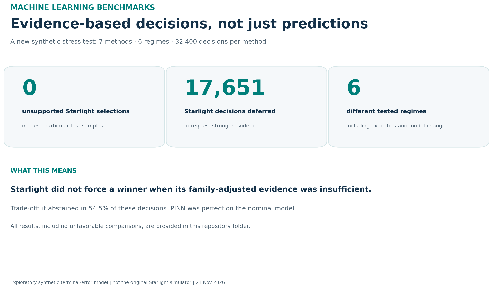
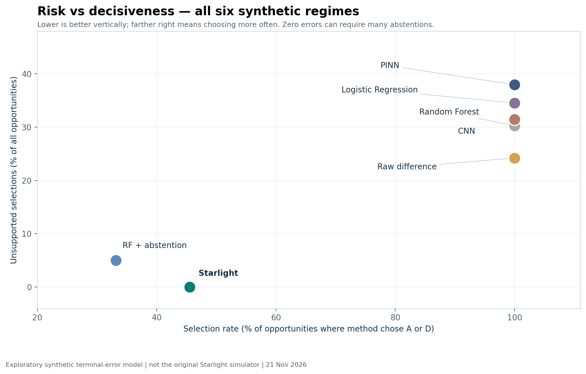
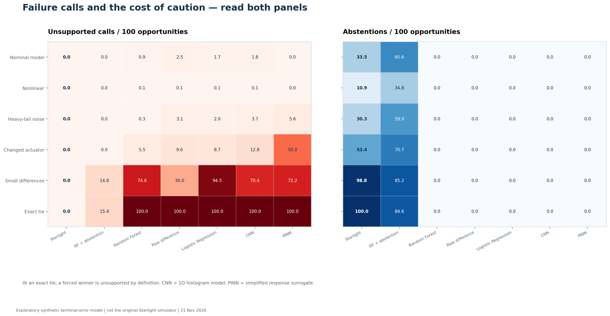
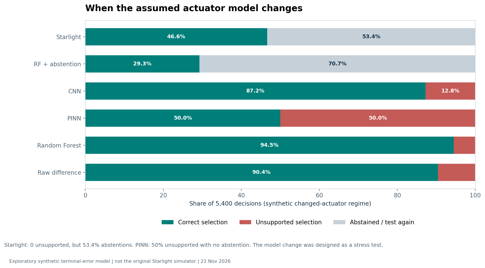
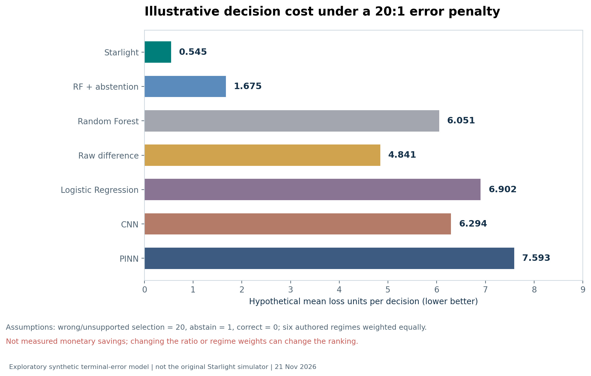
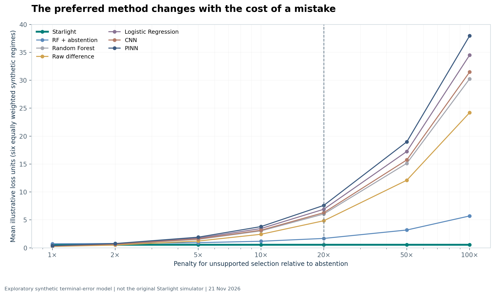
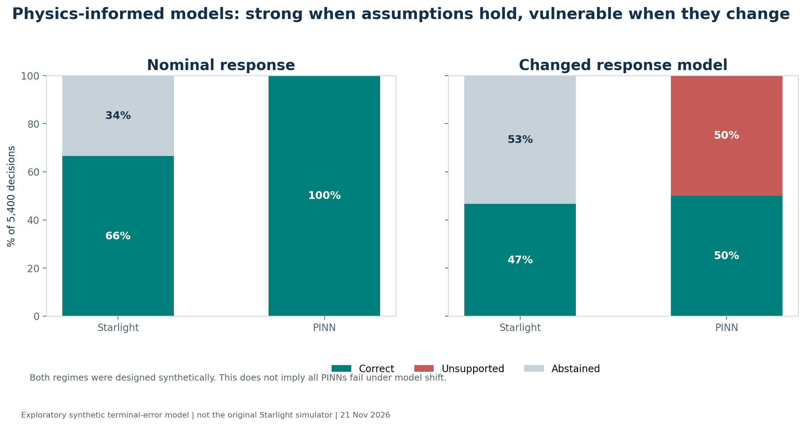
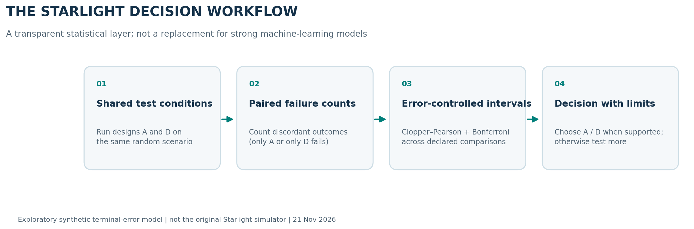

# Judge-friendly gallery: what did we actually learn?

> This is an **exploratory synthetic comparison**. The robot's historical mission simulator was not rerun. Read the [complete results](../README.md) before citing any comparison.

## Thirty-second explanation

> *Most systems make a prediction about which design is better. Starlight asks a second question: is there enough evidence to make that choice? We tested this idea in a separate simulation against several machine-learning approaches. Across 32,400 synthetic decision opportunities, our exact paired-confidence method made no unsupported winner calls—but it also asked for more testing in 54.5% of them. In the nominal environment a physics-informed neural model was more decisive. Our contribution is a transparent way to avoid overconfident engineering choices, not a claim that machine learning never works.*

## The pictures — best viewed in this order

### 1. One-page overview: decision reliability and acknowledged trade-offs

[Open high-resolution vector graphic](figures/00_benchmark_at_a_glance.svg)

### 2. Why selection rate must be considered with the error rate

[Open high-resolution vector graphic](figures/01_risk_vs_decisiveness.svg)

### 3. Full regime × method matrix: errors **and** abstentions

[Open high-resolution vector graphic](figures/02_two_part_risk_and_abstention_matrix.svg)

### 4. What changes when the actuator-response assumption breaks

[Open high-resolution vector graphic](figures/03_changed_actuator_stress_test.svg)

### 5. Illustrative cost comparison at a 20:1 wrong-selection penalty

[Open high-resolution vector graphic](figures/04_decision_cost_assumptions.svg)

### 6. Why the cost assumption affects which method is preferable

[Open high-resolution vector graphic](figures/05_cost_ratio_sensitivity.svg)

### 7. PINN strength under its nominal model versus model mismatch

[Open high-resolution vector graphic](figures/06_pinn_strength_and_limit.svg)

### 8. Plain-language diagram of the paired decision certificate

[Open high-resolution vector graphic](figures/07_how_starlight_works.svg)

## The fair-comparison checklist

1. **What is being predicted?** These are *paired terminal-error failures* in a toy simulator, not full autonomous-car missions.
2. **What counts as a mistake?** Unsupported sign call, or any forced winner on an exact tie.
3. **Can a method abstain?** Starlight and an RF variant can; the other reported baselines are forced-choice.
4. **Is abstention free?** No; the 20:1 illustration charges it one cost unit per refusal.
5. **Could a different method win?** Yes. PINN won the ordinary smooth-regime decision-count comparison; altered RF thresholds can outperform Starlight in some regimes.
6. **Can these graphs go into an IRIS submission?** Only as labelled exploratory additions consistent with the fair's source/data requirements. Do not replace or relabel the original research results.
