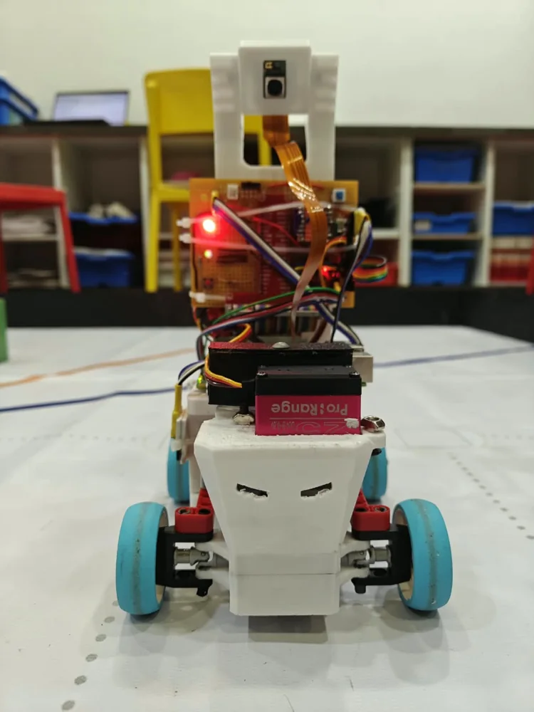
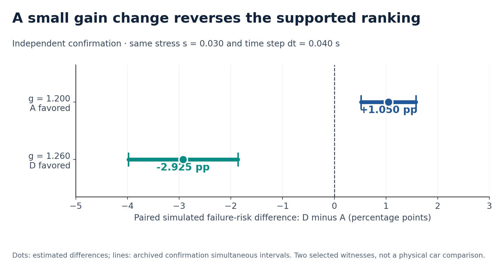
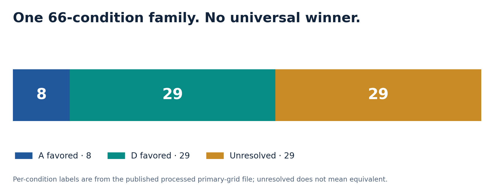

# STARLIGHT

### When a small steering change reverses which robot design wins

**IRIS National Fair 2026–27 · Robotics and Intelligent Machines · ROBO0065**  
**Research article:** *Starlight: Predicting Design Ranking Reversals in an Autonomous Car from Measured Steering Gain*  
**Authors:** Aarav Jalan and Darsh Zaveri · **Research mentor:** Sunil Solanki  
Team Sentio Robotics · Manuscript dated 12 November 2026



Starlight studies a common robotics engineering failure: an architecture that appears better under one assumed actuator response can rank worse after a modest change in steering gain. A working small-scale, Ackermann-steered autonomous car motivated a structured program of physical calibration, paired docking tests, model sensitivity analysis, and decisions under uncertainty.

> **Scientific boundary:** the 752,000 missions are **simulated** A–D comparisons, *not* physical robot trials. Clock–Compass tests are a separate physical controller experiment. This is a faithful processed-data and retrospective read-only analysis release; original raw instrument files and the complete simulation generator are **not** included.

## Key findings

| Published endpoint | Reported result | Interpretation |
|---|---:|---|
| Simulated robot missions | **752,000** | 528,000 primary + 128,000 confirmation + 96,000 model-form |
| Primary simulated conditions | **66** | 8 A-favoring; 29 D-favoring; 29 unresolved |
| Confirmed A-favoring gain setting | **g = 1.200, +1.050 pp** | Positive D-minus-A failure difference means A has lower failure risk |
| Confirmed D-favoring gain setting | **g = 1.260, −2.925 pp** | Opposite ranking at common stress 0.030, time step 0.040 s |
| Physical mismatch heading shift | **Clock 6.42° / Compass 0.48°** | Descriptive means in linkage mismatch cohort, *not* a causal between-cohort estimate |
| Initial safety gate | **10/10** | Overall confirmed cutoffs were **23/24**, not 24/24 |
| Camera metrology p95 | **2.480 mm / 1.286°** | Position met 2.5 mm threshold; heading missed 1.0° threshold |
| Independent decision audit | **8/10** | Includes one unsupported winner call |
| Extended shared failure | **160/204 = 78.4%** | Conditional on at least one physical controller failing |





### How the research works

1. **Build and measure:** Starlight combines cameras, inertial sensing, encoders, ranging, bounded steering and autonomous parking. Physical runs characterize the actuator, control timing and docking behavior.
2. **Pair alternatives:** simulations compare seven-feature architecture bundles **A and D** on common sampled scenarios while steering gain, stress and time step vary. Separately, physical docking evaluates **Clock** (preset turn) and **Compass** (heading feedback).
3. **Quantify uncertainty:** the published finite-family method uses the discordant paired failures and conservative simultaneous intervals to distinguish supported positive/negative signs from unresolved settings.
4. **Decide with limits:** an offline five-action framework separates winner choice, adequacy/equivalence, rejection and need for more trials. The reconstructed example policy is *not* the historical benchmark implementation.

## Start here

| You want to… | Open |
|---|---|
| Read the complete paper | [`paper/Starlight_Engineering_Research_Paper.pdf`](paper/Starlight_Engineering_Research_Paper.pdf) |
| Understand the study in 60 seconds | [`docs/FAIR_JUDGE_GUIDE.md`](docs/FAIR_JUDGE_GUIDE.md) |
| View the public dataset and verification script | [`REFERENCE_DATA/starlight-iris-2026/`](REFERENCE_DATA/starlight-iris-2026/) |
| Find an experiment | [`docs/EXPERIMENT_INDEX.md`](docs/EXPERIMENT_INDEX.md) |
| Examine limitations and disputed claims | [`docs/CLAIMS_AND_LIMITATIONS.md`](docs/CLAIMS_AND_LIMITATIONS.md) |
| Read reconstructed analysis logic | [`starlight/analysis.py`](starlight/analysis.py), [`starlight/statistics.py`](starlight/statistics.py), [`starlight/decision.py`](starlight/decision.py) |
| Inspect historical robot software, CAD and circuit | [`legacy/competition_2026/`](legacy/competition_2026/) |
| View a responsive fair landing page | [`docs/index.html`](docs/index.html) |

## Verify and replay (no robot attached)

Python 3.11+ recommended. From repository root:

```bash
python -m pip install -e '.[science,dev]'
python TOOLS/check_reference.py
python REFERENCE_DATA/starlight-iris-2026/scripts/verify_all_results.py
python scripts/verify_release.py
python -m pytest -q
python -m starlight validate all
python -m starlight replay confirmation --out outputs
```

The first checker performs 455 read-only contract/numerical checks. In the supplied reconstruction, 108 tests passed; GitHub Actions re-runs the checks. The replay writes *new derived reports* to `outputs/` and cannot substitute for the missing original simulator. Recreate the figures with `python scripts/build_figures.py` (requires matplotlib/pandas).

## Read the caveats before citing a result

The physical safety log contains a later failed cutoff. The camera heading goal failed. Published simulation CSVs contain five confirmation interval endpoints that differ from a newly specified exact Clopper–Pearson calculation; the originals were not overwritten. The manuscript reports decision-cost reductions against seven baselines and three ablations, but the released benchmark had contradictory action labels and lacked executable policies. **That numerical claim is not independently validated by this repository.**

See [`reports/INTERVAL_DISCREPANCIES.md`](reports/INTERVAL_DISCREPANCIES.md), [`REFERENCE_DATA/starlight-iris-2026/decision_cost/BENCHMARK_STATUS.md`](REFERENCE_DATA/starlight-iris-2026/decision_cost/BENCHMARK_STATUS.md), and [`docs/PROVENANCE_AND_SCOPE.md`](docs/PROVENANCE_AND_SCOPE.md).

## Publication and credit

This archive is a research communication and reproducibility package, not a certification of physical safety. It does not include raw videos, original experiment acquisition code, full simulator code, or a validated decision-cost benchmark. Images and legacy controller software come from historic project archives. Copyright and co-author permission must be checked before making the repository public; no license is presumed. [Publication checklist](docs/GITHUB_UPLOAD_AND_DISPLAY.md) · [Permissions](docs/RIGHTS_AND_PUBLICATION.md).

**IRIS physical-display reminder:** the 2026–27 rules restrict web addresses and personal photographs to the inside of the research paper/data book and prohibit student identity on the poster. Do not put a repository URL or QR code on the physical poster without organizer approval. [Display checklist](docs/IRIS_DISPLAY_COMPLIANCE.md).
